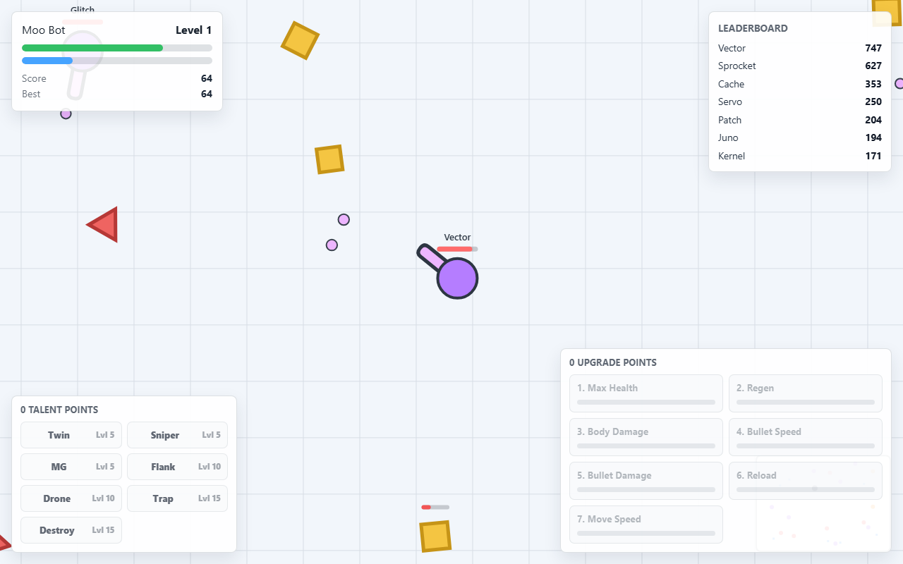

# Moo Tanks

A Diep-style browser tank arena prototype with working bots, upgrades, and shape farming.

[](LICENSE)
[](https://www.typescriptlang.org/)

## [Play it](https://kitsunetech1.github.io/moo-tanks/)

Runs entirely in the browser, no account or install needed. Click Bot Brawl on the menu for an instant match against bots.



## Features

- Player tank with mouse aim, movement, shooting, health, XP, score, and upgrade points.
- Shape farming: squares, triangles, and pentagons to grind for XP.
- Bots that roam, target shapes and other tanks, shoot, strafe, level up, and respawn.
- Leaderboard, minimap, health/XP bars, high score persistence, and pause/restart.
- Local modes: Free For All, Team Deathmatch, Domination, Survival, Maze Arena, Bot Brawl, and Private Lobby.
- Talent branches at level milestones: Twin, Sniper, Machine Gun, Flank Guard, Drone, Trapper, and Destroyer.
- A DOM-free simulation core (`src/simulation`) shared between the browser client and headless tests.
- A separate SpacetimeDB backend scaffold (`backend/spacetimedb`) for a future multiplayer prototype. Not required to play; the current build is fully client-side.

## Use it now

Play it in your browser right now, nothing to install: **[kitsunetech1.github.io/moo-tanks](https://kitsunetech1.github.io/moo-tanks/)**

The rest of this section is only for people who want to run the source code themselves, for example to change the game or work on the multiplayer backend.

## Run it yourself

### What you need

- **Node.js 20.19 or newer** (or 22.12+). This gets you `node` and `npm`. Check what you have by opening a terminal and typing `node -v`. It should print something like `v20.19.0` or higher. If the command errors, or shows an older version, install the current LTS release from https://nodejs.org and try again.
- A web browser. Chrome, Firefox, and Edge all work fine, you already have one.

### Step by step

1. **Open a terminal.**
   - Windows: press the Start key, type `PowerShell`, and open "Windows PowerShell".
   - Mac: open Spotlight (Cmd+Space), type `Terminal`, and open it.

2. **Get the code.** Pick one:
   - No `git` installed: on the [GitHub page](https://github.com/KitsuneTech1/moo-tanks), click the green "Code" button, choose "Download ZIP", then extract the ZIP somewhere easy to find, like your Desktop.
   - With `git` installed:
     ```bash
     git clone https://github.com/KitsuneTech1/moo-tanks.git
     ```

3. **Move into the project folder.**
   ```bash
   cd moo-tanks
   ```
   (If you downloaded the ZIP to your Desktop instead, use `cd Desktop/moo-tanks` or wherever you extracted it.)

4. **Install dependencies.**
   ```bash
   npm install
   ```
   This downloads everything the project needs. It can take a minute or two the first time.

5. **Start the dev server.**
   ```bash
   npm run dev
   ```
   You should see output that includes a line like `Local: http://localhost:5173/`.

6. **Open the game.** Go to `http://localhost:5173/` in your browser (Ctrl+click or Cmd+click the link in the terminal also works).

**It worked if:** you see the Moo Tanks menu, and clicking Bot Brawl drops you into an arena you can move around in with WASD.

**Troubleshooting:**

- **Port 5173 already in use.** Vite picks the next free port automatically and prints the new address in the terminal, use that URL instead. Or close whatever else is already running on that port.
- **`'npm' is not recognized` / `npm: command not found`.** Node.js isn't installed, or you opened the terminal before installing it. Install Node from https://nodejs.org, then close and reopen your terminal.
- **Blank white page in the browser.** Hard refresh with Ctrl+Shift+R (Cmd+Shift+R on Mac). If it's still blank, press F12 to open the browser console and check for a red error message, then confirm `npm install` finished without errors.
- **Game feels choppy.** Close other heavy tabs or programs. This is a prototype, so performance can vary by browser and machine.

### Other useful commands

```bash
npm run build          # build the static site
npm run typecheck      # tsc
npm run smoke          # browser smoke test (needs a running dev/preview server)
npm run sim:smoke      # headless simulation smoke test
npm run backend:check  # cargo check on the backend scaffold
```

## Controls

| Action | Input |
| --- | --- |
| Move | `WASD` or arrow keys |
| Aim | Mouse |
| Fire | Hold left mouse button |
| Toggle auto-fire | `E` |
| Upgrade a stat | Click an upgrade panel button, or number keys |
| Pick a talent | Click an unlocked talent button |
| Pause | `P` |
| Restart after death | `R` |

## Roadmap

This is a prototype, not a finished game. Current state and honest next steps:

- Done: playable single-player arena with bots, upgrades, talents, and local game modes.
- In progress: a dedicated SpacetimeDB backend for real multiplayer (schema and reducers exist, no live server yet).
- Planned: client prediction and snapshot interpolation once the backend is live, then account login, cosmetics, and a native Flutter client.

See `notes/ROADMAP.md` and `notes/DEVLOG.md` for details.

## License

MIT, see [LICENSE](LICENSE).

---

Built by [Kitsune Technologies](https://kitsunetechnologies.org). See more of our work at [kitsunetechnologies.org/work](https://kitsunetechnologies.org/work). Issues and PRs welcome.
